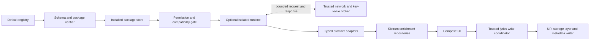

# Extension and enrichment architecture

**VERIFIED IN SOURCE:** [source map](../01-reference-source-map.md) M02–M07/X01–X05 describes upstream; S09/S15/S18/S20 describes Sistrum. None of the proposed classes below exists in Sistrum at the audited baseline.

## PROPOSED boundary

Registry never directly calls runtime. Runtime never obtains database, library path, content URI, file descriptor, Android object or writer. Installation and enablement are explicit separate actions. Adapter parses all output as untrusted, bounded data and validates entity types/matches/URLs. Existing local playback and lyrics remain available without network or installed extensions.

`RegistryRepository` has bundled default URL `https://raw.githubusercontent.com/zarzet/SpotiFLAC-Extension/main/registry.json`. `PackageVerifier` handles bytes, manifest, hash, identity and compatibility before any code evaluation. `ExtensionManager` stores immutable version directories and an atomic active pointer. `RuntimeFacade` has typed Unavailable/Incompatible/Disabled/Timeout/Cancelled/Crashed results. `ProviderAdapter` maps only approved artist-image, motion and lyrics methods into Sistrum repositories; deny download/audio-processing/file APIs. Full upstream feature emulation is outside scope.

## PROPOSED data and cache separation

Use a new app-private enrichment database (proposed `enrichment.db` v1) for provider/extension state, avoiding migration churn in existing library Room. Design and tests precede creation. Existing manual artwork and `provider_lyrics` remain authoritative user selections; enrichment DB stores provenance/word details keyed to content hash, not a second selected-content authority. A transactional outbox/reconciliation protocol handles selection across two stores: save existing content first, then companion provenance tied to hash; missing companion yields legacy provenance, mismatched hash never attaches stale word timings. Do not use cross-database atomicity assumptions.

| Data | Key / storage | Proposed TTL / cap / eviction | Offline and corruption recovery |
|---|---|---|---|
| Registry snapshot | registry canonical URL + body hash; private file + last-check metadata | 24 h checks, manual refresh debounce 60 s; 1 MiB response, last valid snapshot | Keep last valid snapshot and error age; corrupt cache refetch, never empty installed list |
| Installed metadata | registry origin + manifest.name + version + package hash; enrichment DB | No TTL; cap 20 packages initially | Quarantine corrupt version, preserve prior verified version; user state never silently wiped |
| Package bytes/versions | private `extensions/<origin-hash>/<id>/<hash>/` immutable | 16 MiB archive, 32 MiB expanded; active + one known-good prior, 128 MiB aggregate | Remove abandoned staging; rollback pointer journal; refuse space exhaustion |
| Extension settings | origin/id + setting key; DataStore settings, broker KV separate | No TTL; 256 KiB nonsecret KV per extension | Reset one extension explicitly; secrets via Keystore-backed storage, not plaintext DataStore |
| Provider priority/enabled | capability + ordered provider IDs; DataStore | No TTL; dedup/order normalization | Missing providers skipped with status; built-ins/local remain |
| Artist/static artwork | local entity + matched provider ID + asset URL/hash + size variant | metadata 7 d; images 100 MiB LRU | Last authorized cached asset, manual override, then local artwork; corrupt asset evicted |
| Motion artwork | provider/entity ID + asset revision + rendition/validator | metadata 24 h; 200 MiB LRU, per-asset 25 MiB, subject to rights | Only complete verified offline assets; otherwise static; expired authorization forbids display/download |
| Selected lyrics | existing provider_lyrics trackId; provenance companion contentHash | Selected user data has no TTL/automatic LRU; explicit deletion only | Always available offline; stale provenance detached, original text preserved |
| Search candidates | recording fingerprint + provider/version + query/language/settings | 7 d, 10 MiB LRU, only if provider rights permit | Show cached age/source; corrupt entry evicted without erasing selection |
| Negative lyrics result | recording fingerprint + provider/version/settings/locale | Missing 24 h; transport backoff 1/5/30 min; max 2 transient retries per action | Never cache auth/permission failure as NotFound; manual retry bypasses miss with rate limits |
| Wikipedia | entity/provider page ID + revision + language + attribution/license | 30 d, 10 MiB LRU | Authorized cached text with source/revision; clear text+attribution together |
| Match identifiers | local entity fingerprint + provider + provider entity kind/id | 30 d revalidate, max 10,000 LRU automatic matches; confirmed matches pinned | Manual match survives network loss; edits invalidate automatic match |
| Write recovery | operation ID + canonical URI identity + original/staged hashes | Private durable journal, full backup outside cache quota until completion/recovery | Never evict pending backup; surface recovery state and explicit retention cleanup |

All budgets are proposals to measure. Rights-specific shorter retention overrides TTL. Secrets never enter logs/cache keys; include a credential-generation number rather than token in settings fingerprint. Negative results use title/artist/album/edition/duration and content identity, not transient track path alone.

User cache clearing offers separate static/motion/search/About controls and reports bytes. Clearing caches does not uninstall extensions, delete manual overrides/selected lyrics, remove embedded tags, or erase recovery backups. Uninstall removes that extension's executable/KV/secrets and automatic caches; selected lyrics attribution survives where permitted, with source marked uninstalled. Provider metadata never overwrites file-derived metadata during scans.

## PROPOSED schema/migration policy

Version new enrichment records explicitly. Use stable local library IDs as external references without copying sync_tracks/albums/artists; orphan cleanup follows library changes. Export schema and migrate every shipped version with tests. No destructive fallback for library, user settings, active packages or pending writes. Disposable caches alone may be recreated after logging corruption. Existing Room v14 remains unchanged unless a later explicit task specifies a migration and migration tests. Increment metadata parsing version only for a deliberate reader behavior change, after final 002 integration review.

## UNKNOWN / NEEDS VALIDATION and BLOCKED

POC chooses the execution backend only after [runtime](02-runtime-compatibility-audit.md) and [security](03-security-threat-model.md) gates. Provider rights may prohibit proposed persistent caches. No general remote-code sandbox, update authenticity or safe tag writer is claimed implemented.
